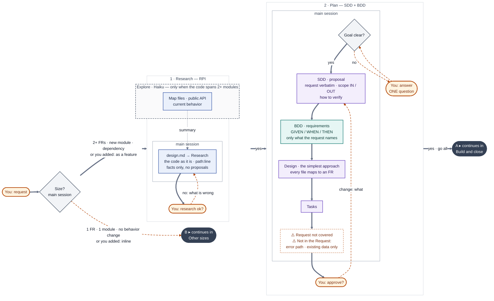
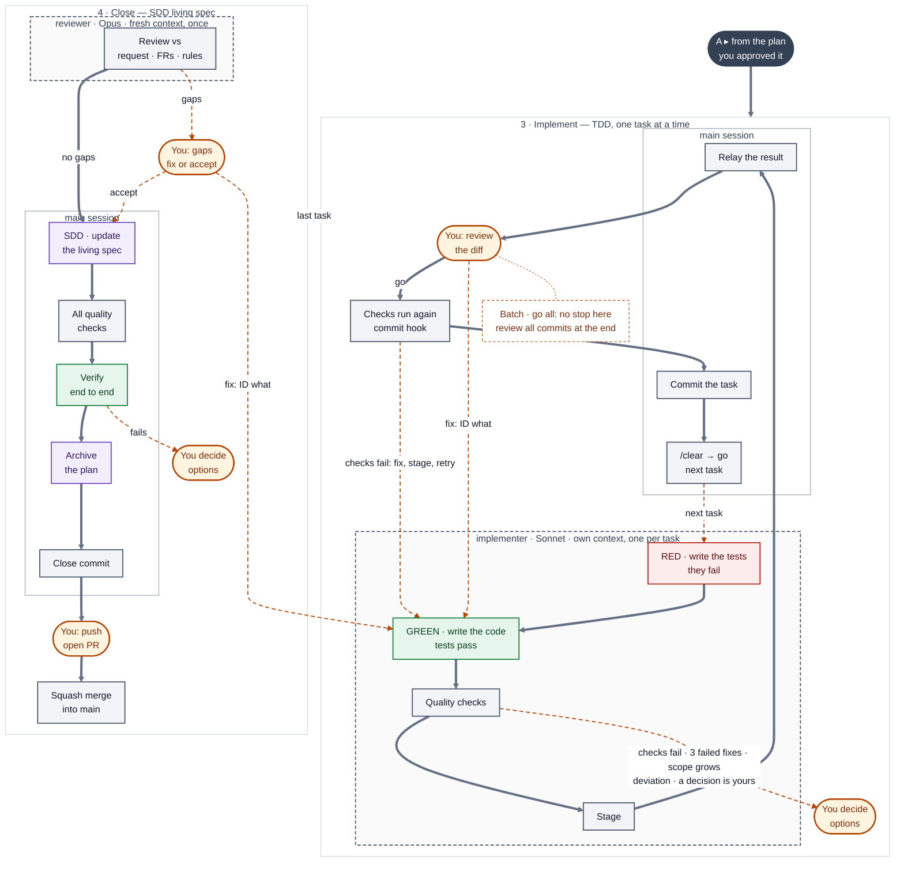
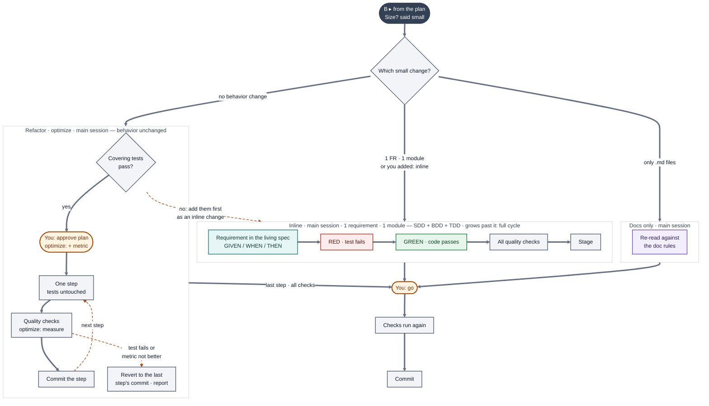

# Spec Driven Development

[](CHANGELOG.md)
[](LICENSE)
[](https://claude.com/claude-code)
[](#methodologies)
[](https://github.com/stevenhdz)

A copy-and-fill setup for **Claude Code** on any project. Every change follows: **spec → your approval → tests + code**. The agent commits only what you approved — only you push.

## Why
AI wrote fast, working code — and also bugs, layers nobody asked for, security holes and technical debt. What worked was taking away its room to improvise: first it writes the spec, I approve it, and only then come tests and code.

- **It guesses what to build** → SDD + BDD: a written, approved spec with concrete GIVEN / WHEN / THEN examples comes first.
- **Bugs and unproven "it works"** → TDD + deterministic gates: a test fails first, a script prints the result.
- **Layers nobody asked for, technical debt** → KISS · YAGNI from the spec to the code — only what the request names, never fragile · your architecture (vertical slices suggested) + a reviewer that checks the diff against the spec and the request.
- **Security holes and fake packages** → secrets denied and never hardcoded, every new dependency checked in its registry and approved by you, `audit` gate.
- **Spec and code drift apart** → living specs + traceability: every FR keeps a test, checked in CI.

## Setup
Requires Claude Code v2.1.271+, Git, and lint/build/test commands. Windows: Git for Windows — the gates run in its Git Bash.

1. Install into your repo root (never overwrites existing files):
   - macOS · Linux · WSL:
     ```
     curl -fsSL https://raw.githubusercontent.com/stevenhdz/spec-driven-development/main/install.sh | bash
     ```
     Pin a version with `| bash -s <tag>`.
   - Windows (PowerShell):
     ```
     irm https://raw.githubusercontent.com/stevenhdz/spec-driven-development/main/install.ps1 | iex
     ```
     Pin a version with `& ([scriptblock]::Create((irm https://raw.githubusercontent.com/stevenhdz/spec-driven-development/main/install.ps1))) -Ref <tag>`.

   Versions: [tags](https://github.com/stevenhdz/spec-driven-development/tags).
2. Fill every `[placeholder]` in `.claude/project.md`, `docs/architecture.md` and `.claude/gates.conf` — `FORMAT_*` needs a formatter you approved as a dependency, or leave it empty. Check with:
   ```
   grep -nE '\[[^]]{2,}\]' .claude/project.md docs/architecture.md .claude/gates.conf
   ```
3. Deny secrets and bulky paths (`.env`, `dist/`, lockfiles) in `.claude/settings.json`.
4. In GitHub → Settings → General → Pull Requests: allow only squash merging — the agent commits each task, the PR lands as one commit.
5. Open Claude Code and describe the change you want.

Existing project: install, then run `/adopt` — it fills steps 2 and 3 from your code.
- It asks once before writing, never touches source code, reports failing gates without fixing them, stages its files and commits them on your `go`.
- `specs/current/` starts empty: existing behavior has no FR until a change touches it — to cover it, request it as a change.

## Use it
- **FR**: one behavior the system MUST have, with GIVEN / WHEN / THEN examples — lives in `specs/current/`, each with a test.
- **Change folder**: `specs/changes/<feature>/` — the plan for one change: proposal, design, FR deltas, tasks `ID-001…`.
- **Size**: the agent picks **inline** (at most 1 FR, 1 module — e.g. one feature folder) or **full cycle** (anything bigger).

**Full cycle — plan**



**Full cycle — build and close**



Colors: blue research · purple SDD · teal BDD · red → green TDD · gray automation · orange capsule = you decide · dark capsule A / B = the flow continues in the diagram that starts with the same letter · solid line = main path · dashed orange = goes back (fix, next task, gaps, next step).

Who runs each step: the box around it — plain = main session · dashed = a subagent in its own context: `Explore` (Haiku) maps code that spans 2+ modules · `implementer` (Sonnet) runs one task · `reviewer` (Opus) checks the branch once.

Terms: requirement = FR · living spec = `specs/current/` · plan = the change folder · quality checks = `gates.sh` (lint, build, tests) · checks run again = the commit hook.

| | What it means here |
|---|---|
| **RPI** | Research → Plan → Implement — you approve between each: `research ok?`, then `approve?`, then every task |
| **SDD** | The spec comes first and stays the source of truth — the change folder holds the deltas, the close merges them into `specs/current/` |
| **BDD** | Every FR is `The system MUST …` with GIVEN/WHEN/THEN scenarios — one test per scenario |
| **TDD** | Each test fails first (RED, recorded by `gates.sh fr`), then the code makes it pass (GREEN) |

A task that returns `blocked`, a deviation, `RED not recorded` or a failing gate stops and waits for you · inside a batch (`go up to ID-00N` · `go all`) tasks run back to back, each one committed, and you review the batch's commits at the end.

1. You: `add discount codes at checkout`.
2. Agent: explores the code, writes `design.md` → Research — files with `path:line`, current behavior, gaps — and replies `research ok?`.
3. You: did it understand the code? → `yes`, or say what it got wrong.
4. Agent: writes the rest of the change folder, replies with its path and `approve?`.
5. You: read `proposal.md` (with its Verify check), `design.md` → Approach, `specs/*/spec.md` and `tasks.md` → `yes`, or say what to change.
6. Agent: runs one task — failing test, code, gates — stages it and stops: `[ID-001 done] … Next: ID-002 — /clear → go`.
7. You: review `git diff --staged` → `/clear` → `go` commits it and runs the next task · `fix: <what>` redoes it.
8. After the last task: the agent checks the branch against the FRs, merges them into `specs/current/`, runs the proposal's Verify check, archives the folder, commits the close and replies with the PR text — you push and open the PR.

**Inline**: the agent edits the FR in `specs/current/`, writes the test, then the code, and stages all three — steps 7–8 without the archive.

**Other sizes**



| Say | Effect |
|-----|--------|
| `<request>` | Starts a change — the agent picks inline or full cycle |
| `<request>, inline` · `<request>, as a feature` | Force the size |
| `yes` | Approve the Research, then the change folder |
| `go` | Approve the staged task — the agent commits it and runs the next one — also resumes the active feature after `/clear` |
| `go up to ID-003` · `go all` | One approval for every task up to ID-003 or the last one — runs them back to back, stops on `blocked` or a deviation from the plan — you review the staged diff once at the end |
| `fix: <what>` · `fix: ID-002 <what>` | Redo the staged task — after a batch, name the task |
| `refactor: <what>` · `optimize: <what>` | Change code without changing behavior — tests untouched |
| `explain` | Replies are short by default — this gets the detailed answer |
| `/adopt` | Fill the setup from an existing project's code (→ Setup) |
| `/clear` | Fresh context between tasks or batches — state lives in the change folder |

| Gates | When |
|-------|------|
| `bash .claude/scripts/gates.sh scoped <files…>` | Changed files only — each task close |
| `bash .claude/scripts/gates.sh full [--no-format]` | Whole project, plus `frs` — and in a PR, `commits`: each subject matches `COMMIT_PATTERN` — feature close, inline change, CI |
| `bash .claude/scripts/gates.sh fr <FR-ID>` | Tests of one FR — proves RED before the code: records it only while the unstaged code files are tests or manifests · fails with fewer tests than GIVEN/WHEN/THEN scenarios — counts the runner lines that name the FR: a lower bound |

No gates: `- Gates: OFF` in the change's `proposal.md` → Scope, next to `TDD` — `scoped` and `full` print `⏭️` for every gate, `fr` still runs so TDD keeps working · inline: always ON.

> [!IMPORTANT]
> Changing code by hand: edit its FR in `specs/current/` first.

> [!TIP]
> Cheapest: plan with Opus, then `/model sonnet` and `go up to ID-00N`.

## Files
| Owner | Paths | `--update` |
|-------|-------|------------|
| You | `.claude/project.md` · `.claude/gates.conf` · `.claude/settings.json` · `docs/` · `specs/` | never touches them |
| Framework | `CLAUDE.md` · `.claude/agents/` · `.claude/skills/` · `.claude/scripts/` · `.claude/hooks/` · `.claude/rules/` (framework files) · `.claude/templates/` · `.claude/doc-rules.md` | overwrites them — list: [`sdd-core`](sdd-core) |

Project rules go in `.claude/project.md` → Project Rules — a framework file you edit is overwritten on the next update.

What the install adds to your repo — **You** = yours to fill and edit · **Framework** = overwritten by `--update`:
```
CLAUDE.md                       Framework · rules every change follows — loads .claude/project.md
.gitattributes                  You       · keeps *.sh with LF endings so the gates run on Windows
.claude/
  project.md                    You       · product, stack, folder pattern, conventions, Project Rules
  gates.conf                    You       · format · lint · build · test · audit commands for gates.sh
  settings.json                 You       · permissions (secrets denied, no git push), the sandbox and the hooks
  doc-rules.md                  Framework · how every .md is written
  agents/
    explore.md                  Framework · read-only code map (Haiku)
    implementer.md              Framework · runs one approved task: test RED → code GREEN → gates (Sonnet)
    reviewer.md                 Framework · checks the branch diff since Base against the FRs (Opus)
  skills/
    create-feature/SKILL.md     Framework · the full cycle: change folder → tasks → review → archive
    adopt/SKILL.md              Framework · /adopt — fills the setup from an existing project's code
    refactor/SKILL.md           Framework · refactor: · optimize: — no behavior change, tests untouched
  scripts/gates.sh              Framework · quality gates: scoped · full · fr
  hooks/protect-secrets.sh      Framework · blocks shell commands that name a secret
  hooks/gate-commit.sh          Framework · blocks a git commit whose files fail scoped gates
  rules/                        Framework · rules loaded only for the files their paths: match
    architecture.md             modules, layers, external data — source files
    code.md                     KISS, no pass-throughs, errors, types, no comments — source files
    testing.md                  behavior tests, mocks, TDD — test files
    ui.md                       semantic, accessible UI — UI files
  templates/                    Framework · copied by the agent, never edited in place
    spec.md                     living spec of one capability
    adr.md                      one project-wide decision
    skill.md                    shape of every skill
    change/                     one change folder: proposal.md · design.md · spec.md (FR deltas) · tasks.md
docs/
  architecture.md               You       · project-wide map and the why
  decisions/                    You       · ADRs
specs/
  current/<capability>/spec.md  You       · living FRs — what the system does today
  changes/<feature>/            You       · the change in progress
  changes/archive/              You       · closed changes
```

## Update
- macOS · Linux · WSL: `curl -fsSL https://raw.githubusercontent.com/stevenhdz/spec-driven-development/main/install.sh | bash -s -- --update [<tag>]`
- Windows: `& ([scriptblock]::Create((irm https://raw.githubusercontent.com/stevenhdz/spec-driven-development/main/install.ps1))) -Update [-Ref <tag>]`

Overwrites the framework files (→ Files) and deletes the ones a new version no longer ships — then review `git diff`. Migration steps per version: [CHANGELOG](CHANGELOG.md). Coming from v1.5 or earlier: the first `--update` only adds `.claude/project.md` — move your values from `CLAUDE.md` into it, then run `--update` again.

## CI
Run `bash .claude/scripts/gates.sh full --no-format` on every PR. In a GitHub PR, check out with `fetch-depth: 0` — `full` fails when the base branch is missing · `audit` runs only when the PR changes a manifest. If two branches add the same FR ID, `frs` fails after the merge — ask the agent to renumber the FR your branch added.

## Methodologies
| Methodology | How this setup applies it |
|-------------|---------------------------|
| **Spec-Driven Development** (OpenSpec style) | Living spec per capability in `specs/current/` · each change in `specs/changes/` as proposal → design → delta spec (ADDED / MODIFIED / REMOVED) → tasks · archived when closed |
| **BDD** (Gherkin style) | Each FR is `The system MUST …` (RFC 2119) with inline Gherkin `GIVEN / WHEN / THEN` — one line, no `.feature` file or Cucumber — every scenario becomes a test, and `gates.sh fr` fails with fewer tests than scenarios |
| **TDD** | Test fails first (RED), proven by `gates.sh fr` — which records `- RED: <FR-ID>` in the change's `tasks.md`, and the reviewer reports an FR without it · ON/OFF per feature, always ON inline |
| **Traceability** | FR → task (`covers`) → test name starting with the FR ID · `frs` gate fails if an FR has no test or a duplicate ID |
| **Your architecture** (Vertical Slice suggested) | `.claude/project.md` → Layer Structure defines the modules — Vertical Slice by default, one folder per feature, replace it with yours · `.claude/rules/architecture.md` · entry layer without business rules · logic layer independent of the transport · imports only through the public API |
| **ADRs** | Project-wide decisions in `docs/decisions/` and `docs/architecture.md` |
| **Clean code** | KISS · YAGNI — also in FRs and Approach (`CLAUDE.md` → Hard Rules → Scope): only what the request names, extras flagged `⚠️ Not in the Request` · no pass-throughs · export only what is imported · exclusive states as one tagged union · no type casts · semantic, accessible UI — enforced by the lint gate (debt rules, unused exports, a `FORBIDDEN` regex on every added line, inline changes too, scaffold paths skipped through `FORBIDDEN_EXCLUDE`) and the reviewer (every rule in `.claude/rules/code.md`) |
| **Testing practices** | Test behavior, not implementation · query like a user (Testing Library) · mock only boundaries (classic TDD) · Arrange / Act / Assert · one test per THEN variant — enforced by the lint gate (`TEST_FORBIDDEN` regex on every added test line, inline changes too, and the stack's test lint plugin) and the reviewer (every rule in `.claude/rules/testing.md`) |
| **Low bureaucracy** | Inline changes (1 FR, 1 module) skip the change folder and the approval round · one approval per plan or batch (`go up to ID-00N` · `go all`) · ONE question at a time · `/adopt` needs one confirmation |
| **Low verbosity** | Short replies by default, `explain` for depth · skills reply with a fixed Output Contract and nothing around it · gates print one line, failing lines only · FRs, change folders and questions are never shortened |
| **English, imperative prompts** | Every `.md` follows `.claude/doc-rules.md`: English, imperative, one idea per line · uppercase `MUST` / `NEVER` / `ALWAYS` only for rules whose violation is costly, with the reason — plain imperative for the rest, no "should" or "try to" · each rule lives in one place · a line that changes nothing gets cut · every skill follows `.claude/templates/skill.md` |
| **Refactoring** (Fowler) | Green tests first · one move per step · gates after each step · tests untouched |
| **Measured optimization** | Baseline first · one change per step · keep a step only if the metric improves |
| **Human in the loop** | You approve the change folder and each task or batch, review the staged diff once per task or the commits once per batch — a batch stops on a deviation from the plan — your `go` commits the task — the agent cannot run `git push` · research → approve → plan → approve → code: no code before approval |
| **Quality gates** | `gates.sh` runs format → lint → build → tests → frs → audit, stops at the first failure and prints one line the agent copies as is — a `PreToolUse` hook runs them on every `git commit` and blocks it on ❌ — same command in CI |
| **Multi-agent** | `implementer` (Sonnet) runs one task — a fix that fails 3 times returns to you · `reviewer` (Opus) checks the diff in a fresh context — gaps against FRs, Hard Rules and the `.claude/rules/` files only, never naming or preferences · `Explore` maps code on Haiku · every agent has a turn cap (`maxTurns`) — a run that hits it stops like a blocked task |
| **Context engineering** | `/clear` per task or batch, state lives in the change folder · skills load on demand · `CLAUDE.md` ≈ 1198 words, only rules every session needs — refactor and full-cycle rules load as skills; architecture, code, testing and UI rules load only for the files they cover · `Explore` runs without it · secrets and bulky files denied |
| **Security** | No hardcoded secrets — env vars documented in `.env.example` · secrets denied in `.claude/settings.json` · a `PreToolUse` hook blocks any shell command that names a secret (`python -c "open('.env')"`, `cp`, `base64`…) — the [sandbox](https://code.claude.com/docs/en/sandboxing) is on, so a script that opens one by itself is blocked too: every `Read` deny becomes an OS-level read block for shell commands (Linux and WSL2 need `bubblewrap` and `socat` — without them, `/sandbox` shows what is missing and commands run unsandboxed) · a new dependency is checked in its registry (exists, age, downloads, repo, look-alike name) and needs your approval · `audit` gate for known vulnerabilities when a manifest changes, locally and in CI |
| **Measure** | `/usage` and `/context` for tokens · `/doctor prompt-audit` after editing rules, skills or agents |
| **Conventional Commits** | One branch per change, one commit per approved task, squash-merged into one commit on main — typed `feat` · `refactor` · `perf`, message from `.claude/project.md`, `gates.sh full` checks every subject in a PR against `COMMIT_PATTERN` |
