# Spec Driven Development

[](CHANGELOG.md)
[](LICENSE)
[](https://claude.com/claude-code)
[](METHODOLOGIES.md)

A copy-and-fill setup for using **Claude Code** on any project — frontend, backend, API, CLI or library.

> [!NOTE]
> Every change follows the same order: **written spec → your approval → tests + code**. The agent never guesses what to build, every rule has a test, and only you commit.

## Requirements
- [Claude Code](https://claude.com/claude-code) v2.1.271 or later
- Git
- Commands for lint, build and tests in your project — any language

## Setup
1. From your repo root, install `project/` — it never overwrites a file that already exists and lists the ones it kept:
   ```
   curl -fsSL https://raw.githubusercontent.com/stevenhdz/spec-driven-development/main/install.sh | bash
   ```
   Pin a version with `| bash -s v1.2.0`. Or copy everything inside `project/` by hand, including the hidden `.claude/` folder.
2. Fill every `[placeholder]` in `CLAUDE.md` (Product, Stack, Layer Structure, Conventions, Hard Rules, Spec Rules, Working Protocol) and the gate commands in `.claude/gates.conf` — `FORMAT_*` needs a formatter you approved as a dependency (e.g. prettier); leave it empty to skip formatting.
3. Edit `docs/architecture.md`: context, the layers in your stack and your decisions — the agent adds slices and project-wide decisions at each feature close.
4. Confirm no placeholder is left. This command must print nothing:
   ```
   grep -nE '\[[^]]{2,}\]' CLAUDE.md docs/architecture.md .claude/gates.conf
   ```
5. Add secret and bulky paths (e.g. `.env`, `dist/`, lock files) to the deny list in `.claude/settings.json`.
6. Run `git init` if the repo has no git.
7. Open Claude Code at the repo root and describe the change you want in plain words.

Optional: for a typed language, install its code intelligence plugin with `/plugin` — symbol lookups replace grep + file reads.

### Existing project
Install `project/` into it as in Setup step 1, open Claude Code and run `/adopt`. The agent asks you to confirm, then does steps 2–5 from your code — it changes no code.

Your first behavior change in each area runs the full cycle — it creates that area's spec.

## Use it

### Example session
```
You:    Create an orders API: create an order with items, reject an empty order, list a user's orders.
Agent:  Size: full cycle — creates the first slice, adds 5 FRs and new dependencies.
        Change folder written: specs/changes/orders-api/ — approve?
You:    yes
Agent:  [ID-001 done] RED: ORDER-01 failed before code · Gates: lint ✅ · build ✅ · tests ✅ — Staged: app/ …
        Next: ID-002 — /clear → go
You:    /clear, then: go
Agent:  … (repeat per task)
Agent:  [Feature closed] Tasks: 3/3 · FRs: 5/5 ✅ — Commit message: feat(orders): …
You:    git commit
```

### Commands
| Say | Effect |
|-----|--------|
| `<request>` | The agent picks the size and announces `Size: inline` or `Size: full cycle` |
| `<request>, inline` | Force a small change: no change folder, one commit |
| `<request>, as a feature` | Force the full cycle: change folder → approval → tasks |
| `refactor: <what>` | Restructure code without changing behavior: plan → approval → small steps, tests untouched |
| `optimize: <what>` | Improve performance without changing behavior: baseline → plan → approval → measured steps |
| `/adopt` | Existing project: fill the setup from your code — no code changes |
| `yes` | Approve the change folder, or start the next task |
| `go` | Run the next task — send it after `/clear` |
| `go up to ID-003` | Run every task up to ID-003 without stopping |
| `fix: <what>` | Redo the last task after reviewing its diff |
| `explain` | Get a detailed answer — replies are short by default |

**Inline or full cycle:** inline when the change adds or modifies at most 1 FR in an existing spec, in 1 existing slice, with no new dependency — no change folder, no approval round, one commit. Anything else runs the full cycle.

### Cheapest way to run a feature
> [!TIP]
> Request the feature with Opus and review the change folder, then `/model sonnet` and `go up to ID-00N` (the last task).

### Rules and guarantees
> [!IMPORTANT]
> Review `git diff --staged` before `go` or committing — `go` is your approval of the last task.

- No code before you approve the change folder.
- `/clear` after each task, unless you ran a batch with `go up to` — the change folder and staged files keep the state.
- Edit the FR in `specs/current/` before changing code by hand.
- Only you commit: the agent stages files but cannot run `git commit` or `git push`.
- A failing gate stops the work; the agent shows the error and proposes options.
- Files denied in `.claude/settings.json` are never read.
- Without a git repo, branch, staging and commit steps are skipped and reported as `no repo`.

### In a team
- `specs/`, `CLAUDE.md` and `.claude/` live in the shared repo — teammates without Claude Code just ignore them.
- Fill the branch and commit formats in `CLAUDE.md` → Working Protocol with your team's convention, ticket ID included.
- Run the full gates in CI so every PR is checked, written by the agent or by hand:
  ```yaml
  # .github/workflows/gates.yml — add the setup and install steps your stack needs before the last step
  on: pull_request
  jobs:
    gates:
      runs-on: ubuntu-latest
      steps:
        - uses: actions/checkout@v4
        - run: bash .claude/scripts/gates.sh full --no-format
  ```
- `frs` checks that each FR has a test by name, not what the test asserts: in the agent flow the `reviewer` flags empty or mislabeled tests; in CI, your PR review does.

> [!WARNING]
> Two branches can add the same FR ID. After the merge, `frs` fails with `FR ORDER-05: ❌ duplicate ID` — ask the agent to renumber the FR your branch added.

## Phases

```mermaid
flowchart LR
    C{"<b>0 · CLASSIFY</b><br/>inline or full cycle"}
    S["<b>1 · SPECIFY</b><br/>SDD + BDD<br/><small>FRs + GIVEN/WHEN/THEN</small>"]
    P["<b>2 · PLAN</b><br/>Design<br/><small>approach + tasks</small>"]
    A{{"<b>3 · APPROVE</b><br/><small>read change folder → yes</small>"}}
    E["<b>edit FR</b><br/><small>specs/current/</small>"]
    I["<b>4 · IMPLEMENT</b><br/>TDD · implementer<br/><small>test RED → code GREEN</small>"]
    V["<b>5 · VERIFY</b><br/>Quality Gates<br/><small>gates.sh + stage</small>"]
    D{{"<b>review diff</b><br/><small>/clear → go · fix</small>"}}
    R["<b>6 · ARCHIVE</b><br/>reviewer + living spec<br/><small>review → merge FRs → full gates</small>"]
    K{{"<b>commit</b>"}}

    C -->|full cycle| S --> P --> A --> I --> V --> D
    D -->|next task / fix| I
    D -->|last task| R --> K
    C -. inline .-> E --> I
    V -. inline: full gates .-> K

    classDef human fill:#fde68a,stroke:#b45309,color:#1f2937
    classDef agent fill:#dbeafe,stroke:#1d4ed8,color:#1f2937
    classDef inline fill:#e5e7eb,stroke:#4b5563,color:#1f2937
    class A,D,K human
    class C,S,P,I,V,R agent
    class E inline
```

Yellow = you act · blue = the agent works · gray = inline only. Inline: the agent edits one FR in `specs/current/`, implements, runs full gates, you commit — no change folder, no archive.

| Phase | Agent | You |
|-------|-------|-----|
| 0 · Classify | Picks inline or full cycle and says why | Override if you disagree |
| 1 · Specify | Writes FRs with GIVEN / WHEN / THEN examples | Answer its questions |
| 2 · Plan | Designs the solution, splits it into tasks | — |
| 3 · Approve | Waits, then creates the branch (format in `CLAUDE.md`) | Read the change folder, reply `yes` |
| 4 · Implement | `implementer` (Sonnet) writes tests and code — failing test first when TDD is ON | — |
| 5 · Verify | Runs `gates.sh`, stages the task | Review the diff, `/clear`, reply `go` |
| 6 · Archive | `reviewer` checks the diff against the FRs; merges FRs into the living spec; full gates; updates `docs/architecture.md`; proposes the commit message | Commit, `/clear` |

## Adapt to your stack
Phases, docs and commands never change. Change only these:

| Part | Where | React | Node API | Python |
|------|-------|-------|----------|--------|
| Stack | `CLAUDE.md` → Stack | React + Vite + TS | Node + Express + TS | Python + FastAPI |
| Slice | `CLAUDE.md` → Layer Structure | `src/features/<feature>/` | `src/modules/<module>/` | `app/<module>/` |
| Business rules live in | `CLAUDE.md` → Layer Structure | pure `rules.ts`, not components — a hook only when state outgrows one `useState` | services, not routes | services, not routers |
| Format | `.claude/gates.conf` | `prettier --write` | same | `ruff format` |
| Full gates | `.claude/gates.conf` | `npm run lint` · `npm run build` · `npm test` · `npm audit` | same | `ruff check` · `mypy .` · `pytest` · `pip-audit` |
| Scoped gates | `.claude/gates.conf` | `eslint <files>` · `vitest related <files>` | same | `ruff check <files>` · `pytest <slice>` |
| Test name | `CLAUDE.md` → Spec Rules | `CART-01 should …` | `ORDER-01 should …` | `test_order_01_…` |
| Denied files | `.claude/settings.json` | `package-lock.json`, `dist/` | `package-lock.json`, `dist/` | `.venv/`, `__pycache__/` |

Write FRs as behavior seen from outside — UI on a frontend, HTTP responses on an API:
```
ORDER-01 — The system MUST reject an order with no items
  GIVEN an authenticated user | WHEN POST /orders with items: [] | THEN the response is 400 with "items required"
```

## Glossary
| Term | Meaning |
|------|---------|
| FR | Functional requirement: one rule the system MUST follow, with an ID like `ORDER-04` |
| GIVEN / WHEN / THEN | A concrete example of an FR; each one becomes a test |
| Living spec | `specs/current/<capability>/spec.md` — what the system does today |
| Change folder | `specs/changes/<feature>/` — `proposal.md` · `design.md` · `specs/<capability>/spec.md` (deltas) · `tasks.md` — what one change adds, modifies or removes |
| Delta | An FR marked ADDED, MODIFIED or REMOVED in a change folder's delta spec |
| Slice | The folder, module or package that holds one feature's code |
| Quality Gates | Format → lint → build → tests → frs → audit. Scoped (changed files) after each task; full at feature close and on inline changes — full adds `frs`: every FR in the living spec still has a test and a unique ID. Format rewrites files and blocks only on a syntax error |
| ADR | Architecture Decision Record: why a project-wide choice was made |

## Files
| Path in `project/` | Purpose |
|--------------------|---------|
| `CLAUDE.md` | Global rules for the agent — fill the `[placeholders]` |
| `.claude/settings.json` | Blocks reading secrets and bulky files, `git commit`, `git push` and Claude attribution · allows `gates.sh` |
| `.claude/gates.conf` | Gate commands — fill them per stack |
| `.claude/scripts/gates.sh` | Formats the changed files, runs the gates in order, stops at the first failure, prints one line · full mode also checks every FR in `specs/current/` has a test and a unique ID |
| `.claude/agents/explore.md` | Replaces the built-in `Explore`: Sonnet, no `CLAUDE.md`, returns a summary only |
| `.claude/agents/implementer.md` | Runs one approved task: TDD, scoped gates, change-folder update, staging (Sonnet) |
| `.claude/agents/reviewer.md` | Checks the staged diff against the FRs, Hard Rules and Testing Rules once per feature — gaps only, never style |
| `.claude/skills/create-feature/` | Full-cycle skill: specify → plan → approve → implement → verify → archive |
| `.claude/skills/refactor/` | Refactor skill: green tests → plan → approve → small steps → verify |
| `.claude/skills/optimize/` | Optimize skill: green tests → baseline → plan → approve → measured steps → verify |
| `.claude/skills/adopt-project/` | `/adopt`: fits the setup to an existing project |
| `docs/architecture.md` | Project-wide map: context, slices, layers per stack, quality attributes, decisions — updated at each feature close; per-change design lives in the change folder |
| `docs/decisions/` | ADRs — copy `000-template.md` |
| `docs/doc-rules.md` | Format rules for every `.md` |
| `specs/current/` | Living specs, one folder per capability (`<capability>/spec.md`) — copy `templates/spec.md` |
| `specs/changes/` | Change folders, one per feature — copy `templates/change/` · closed ones move to `archive/<YYYY-MM-DD>-<feature>/` |
| `templates/` | `spec.md` · `change/` · `skill.md` (for your own skills) |

## Principles
Origin, location and effect of each method: [METHODOLOGIES.md](METHODOLOGIES.md).
- **Method:** lightweight SDD · BDD · TDD (on/off per feature)
- **Specs:** one living spec per capability · deltas per change · RFC 2119 `MUST` · inline `GIVEN | WHEN | THEN` · global FR IDs · FR ↔ task ↔ test traceability
- **Code:** architecture chosen per project · ADRs · KISS / YAGNI · no business rules in entry layers (components, routes, CLI handlers) · no pass-throughs · export only what another file imports · exclusive states as one tagged union · no casts or non-null assertions · semantic, accessible UI · one formatter, run by the gates
- **Tests:** test behavior, not implementation · find elements by role + accessible name · mock only external boundaries · Arrange / Act / Assert · one test per variant a THEN names · test name starts with its FR ID
- **Tokens:** short replies · `/clear` between tasks · tasks run in a Sonnet subagent · skills loaded on demand · gates through one script that prints one line · grep before reading · Explore on Sonnet without `CLAUDE.md` · bulky files denied
- **Measure:** `/usage` (session tokens, prompt cache, share per subagent) · `/context` (what fills the context) · `/doctor prompt-audit` after editing rules, skills or agents
- **Process:** Quality Gates · you approve each task · one commit per feature · Conventional Commits
