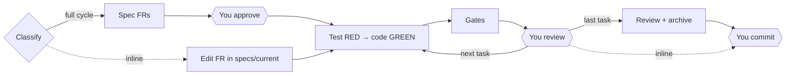

# Spec Driven Development

[](CHANGELOG.md)
[](LICENSE)
[](https://claude.com/claude-code)
[](#methodologies)

A copy-and-fill setup for **Claude Code** on any project. Every change follows: **spec → your approval → tests + code**. Only you commit.

## Setup
Requires Claude Code v2.1.271+, Git, and lint/build/test commands.

1. Install into your repo root (never overwrites existing files):
   ```
   curl -fsSL https://raw.githubusercontent.com/stevenhdz/spec-driven-development/main/install.sh | bash
   ```
   Pin a version with `| bash -s v1.2.0`.
2. Fill every `[placeholder]` in `CLAUDE.md`, `docs/architecture.md` and `.claude/gates.conf` — `FORMAT_*` needs a formatter you approved as a dependency, or leave it empty. Check with:
   ```
   grep -nE '\[[^]]{2,}\]' CLAUDE.md docs/architecture.md .claude/gates.conf
   ```
3. Deny secrets and bulky paths (`.env`, `dist/`, lockfiles) in `.claude/settings.json`.
4. Open Claude Code and describe the change you want.

Existing project: install, then run `/adopt` — it fills steps 2 and 3 from your code.

## Use it
| Say | Effect |
|-----|--------|
| `<request>` | Agent picks the size: inline (1 FR, 1 slice) or full cycle |
| `<request>, inline` · `<request>, as a feature` | Force the size |
| `refactor: <what>` · `optimize: <what>` | Change code without changing behavior |
| `yes` | Approve the change folder |
| `go` · `go up to ID-003` | Run the next task · run tasks up to ID-003 |
| `fix: <what>` | Redo the last task |
| `explain` | Get a detailed answer |

> [!IMPORTANT]
> Review `git diff --staged` before `go` — `go` approves the last task. `/clear` between tasks. Changing code by hand: edit its FR in `specs/current/` first.

> [!TIP]
> Cheapest: plan with Opus, then `/model sonnet` and `go up to ID-00N`.

CI: run `bash .claude/scripts/gates.sh full --no-format` on every PR. If two branches add the same FR ID, `frs` fails after the merge — ask the agent to renumber the FR your branch added.

## How it works


## Methodologies
| Methodology | How this setup applies it |
|-------------|---------------------------|
| **Spec-Driven Development** (OpenSpec style) | Living spec per capability in `specs/current/` · each change in `specs/changes/` as proposal → design → delta spec (ADDED / MODIFIED / REMOVED) → tasks · archived when closed |
| **BDD** (Gherkin style) | Each FR is `The system MUST …` (RFC 2119) with inline Gherkin `GIVEN / WHEN / THEN` — one line, no `.feature` file or Cucumber — every scenario becomes a test |
| **TDD** | Test fails first (RED), proven by `gates.sh fr` · ON/OFF per feature, always ON inline |
| **Traceability** | FR → task (`covers`) → test name starting with the FR ID · `frs` gate fails if an FR has no test or a duplicate ID |
| **Vertical Slice Architecture** | One folder per feature · entry layer without business rules · logic layer independent of the transport · imports only through the public API |
| **ADRs** | Project-wide decisions in `docs/decisions/` and `docs/architecture.md` |
| **Clean code** | KISS · YAGNI · no pass-throughs · export only what is imported · exclusive states as one tagged union · no type casts · semantic, accessible UI |
| **Testing practices** | Test behavior, not implementation · query like a user (Testing Library) · mock only boundaries (classic TDD) · Arrange / Act / Assert · one test per THEN variant |
| **Low bureaucracy** | Inline changes (1 FR, 1 slice) skip the change folder and the approval round · one approval per plan or batch (`go up to ID-00N`) · ONE question at a time · `/adopt` needs one confirmation |
| **Low verbosity** | Short replies by default, `explain` for depth · skills reply with a fixed Output Contract and nothing around it · gates print one line, failing lines only · FRs, change folders and questions are never shortened |
| **English, imperative prompts** | Every `.md` follows `docs/doc-rules.md`: English, imperative, one idea per line · `MUST` / `NEVER` / `ALWAYS`, no "should" or "try to" · each rule lives in one place · a line that changes nothing gets cut · every skill follows `templates/skill.md` |
| **Refactoring** (Fowler) | Green tests first · one move per step · gates after each step · tests untouched |
| **Measured optimization** | Baseline first · one change per step · keep a step only if the metric improves |
| **Human in the loop** | You approve the change folder and each task, review the staged diff and commit — the agent cannot run `git commit` or `git push` · explore → plan → approve → code: no code before approval |
| **Quality gates** | `gates.sh` runs format → lint → build → tests → frs → audit, stops at the first failure and prints one line the agent copies as is — same command in CI |
| **Multi-agent** | `implementer` (Sonnet) runs one task — a fix that fails 3 times returns to you · `reviewer` checks the diff against the FRs in a fresh context — gaps only, never style · `Explore` maps code on Sonnet |
| **Context engineering** | `/clear` per task, state lives in the change folder · skills load on demand · search before reading · short `CLAUDE.md` · secrets and bulky files denied |
| **Security** | No hardcoded secrets — env vars documented in `.env.example` · secrets denied in `.claude/settings.json` · no dependency without your approval · `audit` gate when a manifest changes |
| **Measure** | `/usage` and `/context` for tokens · `/doctor prompt-audit` after editing rules, skills or agents |
| **Conventional Commits** | One commit and one branch per change, typed `feat` · `refactor` · `perf` |
